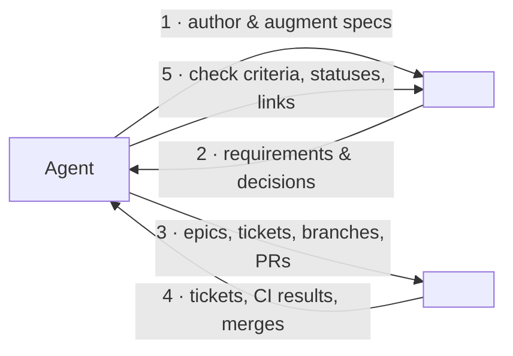
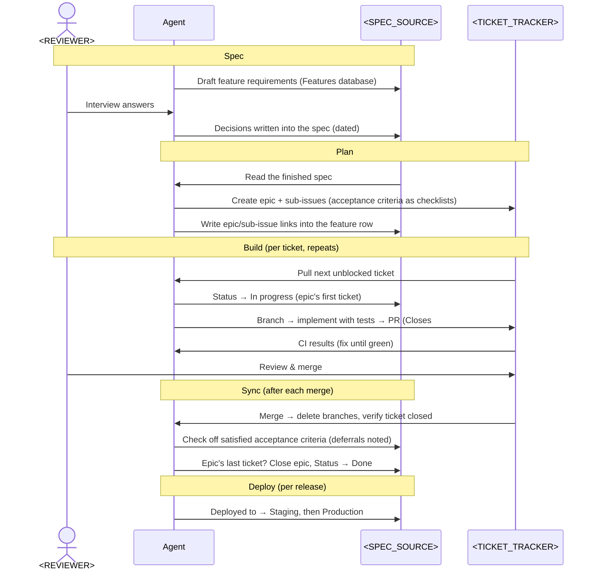

# Development Workflow

How work moves between the coding agent, <SPEC_SOURCE> and <TICKET_TRACKER> on this project. <SPEC_SOURCE> holds the specs (the source of truth for requirements) and <TICKET_TRACKER> tracks the work. The agent carries information between them. <REVIEWER> makes the decisions at two points: answering requirements interviews, and reviewing and merging every PR. The steps the agent follows are in [PROCESS.md](../PROCESS.md).

## The loop

## One feature's lifecycle

## Who owns what

| System | Role |
|---|---|
| **<SPEC_SOURCE>** | The spec of record: requirements, decisions, acceptance criteria, feature status, deploy state. Wins when it disagrees with a ticket. |
| **<TICKET_TRACKER>** | Work tracker and code: epics/sub-issues, branches, PRs, CI. Tickets are summaries; the spec is the contract. |
| **Agent** | Carries state between them: authors specs, cuts tickets, implements with tests, keeps the spec accurate after merges and deploys. |
| **<REVIEWER>** | The human in the loop: answers interviews, reviews and merges every PR (the agent never self-merges), owns infrastructure and credentials. |

## Setting up a stage

1. Duplicate **PRD Template** under the <PROJECT_NAME> hub and rename it `Stage N: Short name`.
2. Add a matching option to the **Stage** select on the Features database.
3. Point the copy's "Features in this stage" linked view at the new Stage option.
4. Hold the requirements interview. Record every decision in the PRD's decisions table with the date. Decisions come before code.
5. Mirror the developer-relevant decision rows into `CLAUDE.md` when the first ticket starts.

## Starting a feature

1. Duplicate **Feature Template** in the Features database, rename it, and set **Stage**.
2. Set **Priority** (P0 must-have, P1 core, P2 nice-to-have, P3 later). Leave **Status** as Backlog until the first ticket starts.
3. Fill Overview, Decisions (dated, from the interview), User Stories, Requirements if needed, Acceptance Criteria as checkboxes, Technical Notes, and Out of Scope.
4. Create the epic and sub-issues in <TICKET_TRACKER>. Fill the feature's **epic** link (or **issue** link for a single-ticket feature) and **sub-issues** as `#12 Short name, #13 Short name`.

## The requirements interview

Decisions come before code. The agent drafts the PRD or feature spec from the source material, then interviews <REVIEWER> on the gaps. Each answer is written back as a dated decision: a row in the stage PRD's decisions table, or a bullet under the feature's `Decisions (from requirements interview, date)`. Each one is stated so a ticket can be checked against it. Ideas that come up but aren't for this stage go to Future Features.
